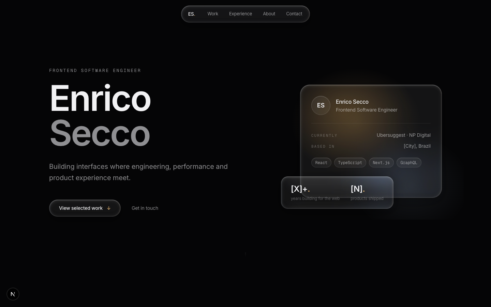
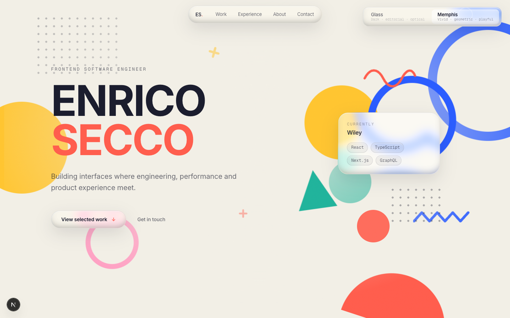

# Liquid Glass Portfolio

Personal portfolio of **Enrico Secco** — Frontend Software Engineer — built as a study in
**material design systems**: the same content, the same glass physics, two opposite worlds.

<!-- TODO: add the live URL after connecting Vercel -->
<!-- 🔗 Live: https://... -->

| Variant A — Liquid Glass | Variant B — Neo-Memphis |
| --- | --- |
|  |  |
| Dark · editorial · optical | Vivid · geometric · playful |

## The concept

Apple's **Liquid Glass** material (WWDC25) is a *null material* — it has no appearance of
its own; everything it shows is borrowed from the world behind it. This portfolio takes
that literally:

- **`/`** — the glass floats in a dark editorial room, lit by anchored light sources.
  Restrained, typographic, almost black at first glance.
- **`/memphis`** — the *identical* glass system dropped inside a living Neo-Memphis
  composition (cream ground, coral/cobalt/yellow geometry). Same components, same
  tokens contract — a different world refracting through the same material.

A floating swatch switcher (a miniature preview of each world) toggles between them.

## The material system

Every glass surface implements the three real properties of the Apple material, in tiers:

1. **Lensing** — true backdrop refraction via an SVG displacement map fed to
   `feDisplacementMap` through `backdrop-filter: url(#lg-lens)`. Distortion lives only in
   the edge ring; the center stays optically clear. Chromium-only, detected via
   `navigator.userAgentData`.
2. **Specular illumination** — a spring-driven glare that trails the pointer with physical
   inertia, plus a static lens-ring bevel on every surface.
3. **Environmental adaptation** — `blur + saturate(180%)` amplifies whatever world sits
   behind the glass; tokens re-declare the material per variant (`.memphis` scope).

Graceful tiers: Chromium desktop → refraction · Safari/Firefox/touch → frosted
blur+saturate · no `backdrop-filter` → solid surface · `prefers-reduced-motion` → static.

## Motion system

- One shared `requestAnimationFrame` loop drives everything continuous: Lenis smooth
  scroll, two lerped pointer channels (`--px/--py` ambient, `--cx/--cy` cursor) and a
  `--scroll` channel for scroll-reactive layers. Nothing else owns a loop.
- Springs (stiffness 260 / damping 22) for UI; `cubic-bezier(0.32, 0.72, 0, 1)` everywhere else.
- Scroll-directed ambient lighting: the dark room warms at the hero, cools mid-page,
  warms again at the contact.
- In the Memphis variant, a **traveler shape** morphs and journeys across the page as you
  scroll — hero ornament → work column dot → timeline marker → contact sun.
- Everything compositor-friendly (`transform`/`opacity`/`filter` only), interruptible, and
  disabled under `prefers-reduced-motion`.

## Performance

Measured with Lighthouse (mobile emulation, production build):

| Route | Performance | CLS | Accessibility |
| --- | --- | --- | --- |
| `/` | 91 | 0 | 96 |
| `/memphis` | 95 | 0 | 96 |

Hard budget: max ~6 active `backdrop-filter` elements per viewport, entry animations
reserve layout space (zero CLS), fully static prerender.

## Stack

Next.js (App Router) · React · TypeScript · Tailwind CSS v4 · Motion (Framer Motion) · Lenis

## Getting started

```bash
npm install
npm run dev     # http://localhost:3000
npm run build   # static production build
```

All content (projects, experience, skills, links) lives in a single typed module:
[`src/content/content.ts`](src/content/content.ts) — no strings inside components.

## Project structure

```
src/
  app/               routes (/ and /memphis), tokens (globals.css), SEO (robots, sitemap)
  content/           single source of truth for all portfolio content
  components/
    primitives/      GlassSurface · MagneticButton · Reveal
    sections/        Variant A sections (dark editorial)
    memphis/         Variant B sections + Memphis shape vocabulary + traveler
    Runtime.tsx      the single rAF loop (Lenis + pointer + scroll channels)
    LensFilter.tsx   SVG displacement refraction + capability detection
```

## Design specs

The build was driven by two written specifications, kept in the repo:

- [`PORTFOLIO_SPEC.md`](PORTFOLIO_SPEC.md) — the Liquid Glass design system spec
- [`MEMPHIS_SPEC.md`](MEMPHIS_SPEC.md) — the Liquid Glass × Neo-Memphis creative direction

---

Designed and built with [Claude Code](https://claude.com/claude-code).
